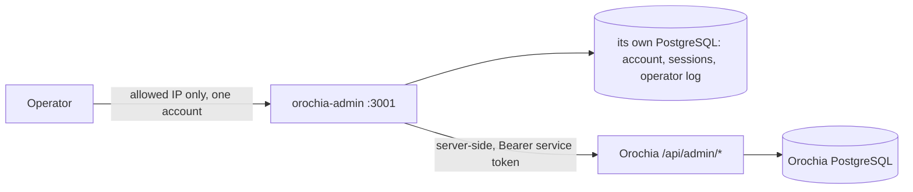

<!-- krizaka-header -->
<div align="center">

<picture>
  <source media="(prefers-color-scheme: dark)" srcset="https://raw.githubusercontent.com/krizaka/.github/main/profile/assets/orochia-dark.svg">
  
</picture>

# Orochia Admin

**Creators get paid. Every cent, exactly once.**

The operator console of Orochia: 18 U.S.C. § 2257 creator verification, content-report triage, catalogue, auctions, treasury and payouts, backups — a server-side BFF over the Orochia admin API, with one operator account and its own database.

[](https://github.com/krizaka/orochia-admin/actions/workflows/ci.yml)
[](LICENSE)
[](https://dev.orochia.com)
[](https://dev.orochia.com)

[Documentation](https://dev.orochia.com) · [Website](https://www.krizaka.com) · [Krizaka on GitHub](https://github.com/krizaka)

</div>
<!-- /krizaka-header -->

---

## What it does

| Screen | Backed by | Purpose |
| :--- | :--- | :--- |
| Overview | `GET /api/admin/overview` | Ledger totals, catalogue state and the three queues that need a human |
| 2257 Creator Verification | `GET/PATCH /api/admin/creators` | Approve a creator after their identity and age records are checked — only verified creators can upload |
| Content Reports | `GET/PATCH /api/admin/reports` | Triage reports; suspected minors and non-consensual content first |
| Treasury & Payouts | `GET /api/platform/treasury`, `GET/PATCH /api/admin/payouts` | Revenue from the ledger; settle (with transfer reference) or fail (with reason, refunds the balance) payouts |
| Catalogue | `GET /api/bunny/analytics` | Videos by encoding state, total views |
| Creator Registry | `GET/PATCH /api/admin/creators` | All creators, activity, suspend/restore uploads |

| Auctions | `GET/DELETE /api/admin/auctions` | Open, awaiting and sold auctions, credits held; cancel with a reason |
| Platform & Database | `/api/admin/platform*` + the console's own log | Migration history, rows per table, backups, factory reset (development), operator log |



## Run locally

```bash
cp .env.example .env.local      # its database, the operator account, the token shared with Orochia
npm install
npm run dev                     # http://localhost:3001 — sign in with AUTH_OPERATOR_EMAIL / AUTH_OPERATOR_PASSWORD
```

Start [Orochia](https://github.com/krizaka/orochia) first, with the same `OPERATOR_API_TOKEN` in its `.env`.
Create the console's database once:
`docker exec orochia-postgres-dev psql -U orochia_user -d orochia_db -c "CREATE DATABASE orochia_admin"`.

## Environment

Every variable is named `<CONTEXT>_<THING>` after the part of the console it configures — never after a product or a
vendor (krizaka/.github#46). Declared once in [`lib/env.ts`](lib/env.ts) (zod); a deployed console whose environment is
incomplete or malformed does not start. This table is generated from it (`npm run docs:generate`).

<!-- env -->
### Application — `APP_`

| Variable | Production | Secret | Default | What it does |
| :--- | :---: | :---: | :--- | :--- |
| `NEXT_PUBLIC_APP_ENV` *(build)* | — |  | `local` | The build badge in the header (`v<version> · <env> · <commit>`), never shown with `production`. |
| `APP_COMMIT_SHA` *(build)* | — |  |  | The commit the image is built from (App Platform: `${_self.COMMIT_HASH}`); else `git rev-parse`. |

### Database — `DATABASE_`

| Variable | Production | Secret | Default | What it does |
| :--- | :---: | :---: | :--- | :--- |
| `DATABASE_URL` | ✓ |  |  | The console's own database (operator account, sessions, operator log) — never the platform's. |
| `DATABASE_CA_CERT` | recommended |  |  | CA of a managed PostgreSQL (App Platform: `${admin-db.CA_CERT}`): TLS verified against it. |

### Authentication — `AUTH_`

| Variable | Production | Secret | Default | What it does |
| :--- | :---: | :---: | :--- | :--- |
| `AUTH_OPERATOR_EMAIL` | ✓ |  |  | The single operator account: nobody signs up, there is no other user. |
| `AUTH_OPERATOR_NAME` | ✓ |  |  | The operator's display name. |
| `AUTH_OPERATOR_PASSWORD` | ✓ | ✓ |  | The operator's password (12+ characters), brought in line at sign-in. |
| `AUTH_ALLOWED_IPS` | ✓ |  |  | Comma-separated client addresses (`do-connecting-ip`) allowed to reach the console, sign-in included. Empty in production: nobody. |

### Operator — `OPERATOR_`

| Variable | Production | Secret | Default | What it does |
| :--- | :---: | :---: | :--- | :--- |
| `OPERATOR_API_URL` | ✓ |  | `http://localhost:3000` | The platform's API the console operates (`/api/admin/*`). |
| `OPERATOR_API_TOKEN` | ✓ | ✓ |  | Service token shared with the platform (same value and name on both deployments); never reaches the browser. |
| `NEXT_PUBLIC_OPERATOR_PLATFORM_URL` *(build)* | recommended |  | `http://localhost:3000` | The platform's public site, for the links to a video, a profile or the home. |
<!-- /env -->

## Deploy

`deploy/Dockerfile` builds a standalone image (port 3001); `deploy/app-spec.dev.yaml` creates the App Platform app in
the `orochia` project with its own dev database. Secrets (`AUTH_OPERATOR_PASSWORD`, `OPERATOR_API_TOKEN`) are app
variables, never in git. `AUTH_ALLOWED_IPS` lists the only addresses that reach the console.

## License

Apache License 2.0 — see [LICENSE](LICENSE).

---

<sub>A Krizaka product · [krizaka.com](https://www.krizaka.com) · Apache-2.0</sub>
